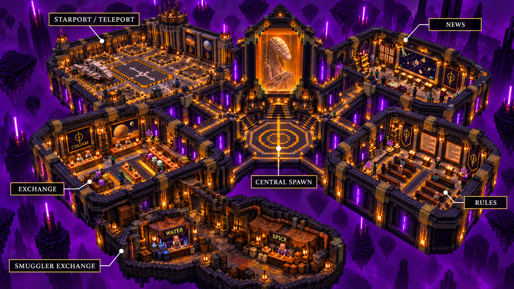

# Spacing Guild lobby world

A separate **Minecraft Java / Paper 1.21.4 / Java 21** End-dimension lobby. The world is already built and saved in [`../worlds/Dune-Guild-Lobby-1.0.0.zip`](../worlds/Dune-Guild-Lobby-1.0.0.zip); the deterministic builder and runtime companion are here. It does not replace a planet world.



The image above is AI concept art generated with the built-in image tool, not an in-game screenshot. Actual architecture uses vanilla block geometry; the End sky is vanilla, not a shader or a custom purple sky. Ordinary vanilla light is not coloured. The saved world contains enclosed roofs; the concept removes them to show the rooms. [`previews/saved-world-plan.png`](previews/saved-world-plan.png) is generated from the actual saved blocks.

## Rooms

| Room | Centre X/Z | Contents |
|---|---|---|
| Central spawn | 0 / 0 | Safe arrival at **0.5, 81, 10.5**, facing north; block-built aquatic Navigator inside an amber glass tank, Guild liaison |
| Starport / teleport | -78 / -58 | Dune II inspired square arrival apron, grounded frigate, control tower and **five raised launch pads** with striped edges, lights and destination consoles |
| Official Exchange | -66 / 40 | CHOAM counters, commodities, storage and Exchange Broker |
| News | 62 / -42 | Illustrated dispatch panel, reading benches and interactive news lecterns |
| Rules | 62 / 37 | Charter panel, benches and interactive rules lecterns |
| Smuggler exchange | -66 / 101 | Dim side passage, screens, brown awnings, crates, worn copper; separate **water** and **spice** seller NPCs |

All rooms connect by enclosed corridors. Launch consoles ask for confirmation. There are no Nether portals: the starport is a landing/launch design.

## Install the already built world

1. Use a **separate lobby Paper backend**. Stop that server before copying files. Leave existing planet servers and worlds in place.
2. Extract the ZIP into the server directory. It contains `guild_lobby/`, `plugins/DuneLobby-1.0.0.jar`, and these setup instructions. Do not extract over an existing `guild_lobby`; preserve it separately first.
3. Install [ImageFrame from Spigot](https://www.spigotmc.org/resources/106031/). The tested version is **2026.1.5.0**, which lists Minecraft 1.21.4 support. With Python available, `python DuneLobby/tools/install_imageframe.py /path/to/lobby-server` downloads that exact dependency and verifies its SHA256. The third-party JAR is not vendored in this repository/package. Dependency source: <https://github.com/LOOHP/ImageFrame> (GPL-3.0).
4. Start Paper. DuneLobby loads `guild_lobby` as **THE_END**, preserves the saved blocks and restores the eleven ImageFrame panels. Artwork is included in DuneLobby's JAR, so no remote artwork hosting is required. ImageFrame map IDs are allocated for this server rather than trusting IDs from another world. Keep ImageFrame installed to render the pictures.
5. `/lobby` returns to central spawn. Console `dunelobby verify` checks spawn clearance, room/pad/vendor accessibility, NPCs and artwork. Console `dunelobby artwork` restores decorations if required; it reuses registered image maps instead of creating duplicates.

DuneLobby creates a world only when **console** runs `dunelobby build`, and refuses if a folder with that name already exists. This command is for reproducing a new world, not installing the included map. No planet file or existing lobby structure is regenerated on startup.

Keep Paper's default primary world as a small bootstrap world; the plugin loads the End lobby as a secondary world and routes joins/respawns there. Do not use `guild_lobby` as `level-name`, since that loads it as the primary overworld before the plugin can select THE_END. Example **lobby backend** settings:

```properties
level-name=lobby_bootstrap
level-type=minecraft:flat
generator-settings={"layers":[],"biome":"minecraft:the_void","structures":{}}
generate-structures=false
allow-nether=false
spawn-protection=0
```

For an existing multiworld server instead of a dedicated backend, set `join-at-lobby: false` and `respawn-at-lobby: false` in `plugins/DuneLobby/config.yml` to preserve other plugins' routing. The shipped ZIP is a **Paper multiworld import**, not a standalone singleplayer save or a schematic. DuneLobby supplies the void generator and prevents new End terrain around the build.

## Network and economy

- Optional DuneEss: launch consoles call the player's existing `/duneess travel <planet>`, preserving configured fares, permissions and Arrakis checks. The Navigator liaison opens `/duneess travel`.
- Without DuneEss: consoles teleport to an already loaded planet world, or request a Velocity/Bungee `Connect` using the names in the lobby config. Requests have no delivery acknowledgment and charge no fare. Configure and test the destinations on your own network; no live server deployment is performed by this package.
- The Exchange Broker opens `/dune exchange` when DuneCore is installed. Without DuneCore it explains that the official market needs that integration; no fake Solaris balances are created.
- Both smuggler sellers work without DuneCore/Vault: one drinking water potion for 4 emeralds, one orange-dye spice sample for 8 emeralds (configurable). **These are lobby barter goods**, deliberately not tagged finite Arrakis water or redeemable DuneCore spice. This avoids minting Solaris or faction rewards outside the existing economy. They are stationary, named, invulnerable villagers with custom merchant menus.
- News and rules lecterns display the text in the companion config. Run `dunelobby reload` after edits. Illustrated noticeboards are static artwork, not a live website feed.

Velocity example (adapt the backend address):

```toml
[servers]
lobby = "127.0.0.1:25570"
# Keep existing planet entries.
try = ["lobby"]

[advanced]
bungee-plugin-message-channel = true
```

Use your existing modern forwarding configuration and forwarding secret. Do not install DuneTerrain on a dedicated lobby backend, since it is intended to create a selected planet. DuneCore/DuneEss remain optional and their shared economy/database setup is unchanged.

## Protection and build

Visitors cannot break/place blocks, manipulate frames, use ordinary container blocks or damage entities in the lobby. Explosions do not damage blocks, hostile spawns are suppressed, and falling below the build returns the player to spawn. Operators have `dunelobby.build` for maintenance; other worlds are unaffected. This companion does not implement a general-purpose region protection system for other plugins' console edits.

Build the companion with `gradle -p DuneLobby build` using Java 21 and Gradle 8.14+. Typographic boards are reproducible with `python DuneLobby/tools/prepare_boards.py` (Pillow). Existing project artwork is copied unchanged from `docs/artwork`. The build embeds the local artwork; it downloads no artwork.

Design references: [1984 Navigator / heighliner production artwork](https://www.duneinfo.com/arrakis/navigators/), [Dune II Starport](https://dunerts.wiki.gg/wiki/Starport_(Dune_II)). Reference designs are interpreted in blocks; the original game sprites and film stills are not included as new assets.

## Validation

See `VALIDATION.md` for the recorded build, actual saved-world checks and limitations. The package includes `manifest.json` with file hashes. No live network, paid Solaris transfer or real player account is used in local validation.
