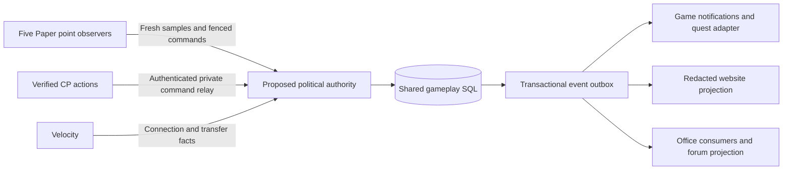
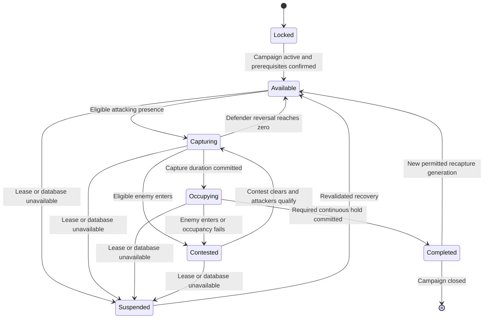

# Conquest and imperial legitimacy design

Design for Owner review, 6 November 2026. Implementation requires a separate approval. The intended Sunday 8 November Alpha date remains a conditional testing target; the conquest system is not ready for a live session simply because this design is complete.

The proposed system makes territorial conquest a recorded cause of political succession. An eligible faction funds a declared invasion, captures its configured objectives and proves occupation. A single authoritative settlement then changes the imperial term according to the selected policy. Council decisions, public objectives and territorial outcomes affect legitimacy through bounded, audited events.

[INTEGRATION.md](INTEGRATION.md) establishes the existing source contracts. Every service, table, endpoint, command extension and rule below is **new proposed functionality**, except where explicitly identified as an existing dependency. Initial balance values are configurable proposals.

## 1 System architecture

Use one political authority in the shared gameplay MySQL database. Each Paper backend observes only the worlds and strategic points assigned to its configured server ID. It produces immutable eligibility/occupancy samples on the Minecraft thread; bounded worker tasks validate those samples and commit progress. A leased coordinator handles invasion deadlines, elections, council resolutions and imperial settlement. Velocity routes players and notifications; it cannot award victory, money or office from a proxy message alone.

The coordinator lease has a database expiry and increasing fencing token: an old process cannot commit after a replacement acquires authority. Capture ownership is likewise scoped to a point's backend lease. SQL transactions enforce state versions; process-local locks only prevent redundant work.

Playable **factions** are the five canonical Core houses. Website **clans** are independent membership groups. Existing elected faction leadership authorizes a declaration; a clan owner/officer authorizes use of that clan's funds. Neither role implies the other. Default funding uses a new faction political treasury funded by explicit transfers. A later clan contribution requires a recorded spending mandate, not a leader's arbitrary access to every clan wallet.

All mutations recheck current linked game identity, faction/leadership, relevant mandate, phase, version and funds. A signed request or open menu proves neither current authority nor eligibility. Staff administration remains separate from Emperor/council powers, and paid ranks confer no combat, capture, voting or succession advantage.

## 2 Capture point configuration specification

Store immutable published definition versions. Drafts are editable; publishing validates the whole point graph and world mapping. Active invasions retain their accepted definition hash. Changing a palace, radius or reward during combat requires an audited abort/reschedule rather than silently rewriting the campaign.

| Field | Proposed contract |
| --- | --- |
| pointId and version | Stable UUID; positive revision; display slug is not identity. |
| serverId | Exact arrakis, caladan, giedi_prime, kaitain or sigma_draconis_iv. Lobby/proxy cannot host strategic objectives. |
| worldId and location | Verified persistent world UUID, finite x/y/z and known world bounds. Display names/seed guesses cannot identify a world. |
| volume | Default cylinder, radius 25 blocks and vertical half-height 8; configurable radius 1–64 and half-height 1–32. An explicit sphere option uses the same authoritative coordinates. |
| kind | Capital, palace, fortress, spaceport, spice field, water reservoir, mine, trade centre, government or communications. Kind supplies presentation, not hidden authority. |
| controller | Canonical faction ID or neutral; runtime owner/version is stored separately from the definition. |
| objectiveMode | CAPTURE_ONLY, CAPTURE_AND_HOLD, HOLD_CONTROL, SEQUENTIAL, MULTI_POINT or DEFEND. |
| captureSeconds and holdSeconds | Default 300 and 900; integer 1–7200 where relevant. Zero-duration goals are rejected. |
| prerequisites | Acyclic objective IDs plus required ownership, treaty and phase conditions; all references must exist in the pinned campaign version. |
| participation | Default 3 eligible attackers, maximum 12 counted per side; current enemy presence contests. Ally roster and count limits fixed at declaration. |
| contestPolicy | PAUSE by default; optional configured defender-only reversal or decay with explicit rates. No random winner on equal counts. |
| holdPolicy | Default continuous occupancy/control; contest, insufficient attackers or stale observation resets the current hold interval. |
| rewards | Default no currency. A finite funded budget and unique completion receipt are mandatory for any later monetary reward. |
| consequences | Allowed typed effects: point ownership, objective completion, legitimacy event or settlement request. Never arbitrary console commands. |
| visibility | Public, participants or staff. Exact unpublished positions and hidden prerequisite/defender information stay private. |
| recovery | Grace policy, maximum suspension, cooldown and neutralization rules; operator action always records reason and actor. |

World positions must be surveyed by an administrator. The Kaitain example therefore names `kaitain-spaceport`, `kaitain-fortress`, `kaitain-gates` and `kaitain-palace` but supplies no invented coordinates or world UUID. An incomplete definition stays disabled. Publication also checks overlap, spawn/claim protection, safe defender routes, total objective timing and recoverable access; no world regeneration or forced chunk loading accompanies publication.

The same specification supports all five planets. A new point does not declare an invasion: it remains inactive for competitive capture until linked to an authorized active campaign or an explicitly approved peacetime objective.

## 3 Capture state machine

Separate persistent territorial owner from the current campaign's capture progress. Entering a radius changes neither owner nor imperial office until a committed transition confirms it.

For CAPTURE_ONLY, capture completion goes directly to Completed. HOLD_CONTROL starts occupation only when the required owner and occupancy are already true. DEFEND succeeds at the campaign deadline only if ownership survived a real hostile attempt and the configured minimum defensive participation was recorded; the initial proposal requires three eligible defenders for five minutes. An empty or purely nominal attack can fail without granting a defensive quest reward or legitimacy increase. Sequential/multiple modes aggregate the same point transitions through the quest graph.

A permitted recapture opens a new point-progress generation. Earlier objective/reward receipts remain terminal and cannot pay again; live ownership predicates still determine whether dependent objectives can advance. This separates repeatable territory changes from an immutable completed quest milestone.

Default progress rules are deterministic. Qualifying attackers with no eligible enemy gain at most one second per fresh one-second sample, regardless of surplus players. Both sides present means pause. Defenders alone reverse existing capture progress at the configured rate; nobody present causes configured decay. Reverse/decay never changes ownership by itself. A completed point can be recaptured only under an explicit campaign rule and increments its version; downstream prerequisites are re-evaluated. A prerequisite lost during palace occupation resets that occupation by default.

Only alive online Survival players in the correct world/volume and current enrolled faction/ally roster count. Spectators, vanished/test actors, unverified links and disconnected/transferring players do not count. Activity qualification requires a new server-attested activity measure; existing worm outcomes or wallet size are not AFK evidence. Default design uses recent meaningful movement/activity and sustained eligibility, with bounded contribution per UUID/account. Macro/alternate-account suspicion goes to staff review rather than automatic household/IP punishment.

Use server monotonic elapsed time for observation and database UTC time for deadlines. Reject samples older than two seconds, duplicates, gaps beyond the allowed observation interval, mismatched versions or an obsolete lease token. Accumulate verified hold milliseconds from accepted samples; subtracting a start timestamp from wall-clock time is insufficient. Count only bounded fresh elapsed time; a restart, lag spike or replay cannot fast-forward capture. Continuous hold resets on an unobserved gap. Significant clock discontinuity suspends the campaign for the published recovery policy. No offline time is awarded.

## 4 Invasion and quest integration

Proposed invasion phases are DRAFT, FUNDED, PREPARING, ACTIVE, SETTLING, VICTORY/DEFEAT/ABORTED, then COOLDOWN. A declaration transaction verifies elected leadership and funding authority, reserves target/campaign slots, debits the finite treasury into campaign escrow, snapshots allies/objectives and commits a public announcement event. Capture cannot start this transaction.

Default preparation is 24 hours and the combat window 90 minutes. The defending faction publishes recurring fair windows; a declaration selects the next compatible window far enough away for full preparation. Repeatedly logging out does not veto an announced campaign. If objective hosting or notification delivery cannot be confirmed before activation, reschedule under the published outage policy. Keep a global limit of one imperial-capital campaign and a configurable per-faction limit to prevent overlapping obligations.

Notification delivery is retried from the outbox. The campaign records announcement time, recipient scope and acknowledgements where available. An undelivered Discord message is not proof that defenders were informed; mandatory in-game/website notices and preparation duration must also be satisfied. Invitations/reveals do not leak private objective coordinates to public channels.

The existing DuneQuests worm engine supplies a useful asynchronous scheduling and conditional-finish pattern, but needs a new versioned objective adapter. Proposed objective contracts are CAPTURE_POINT, HOLD_POINT, DEFEND_POINT, RECAPTURE_POINT, CONTROL_MULTIPLE_POINTS and CAPTURE_IN_SEQUENCE. Declaration creates the campaign's pinned quest instances in locked state; the committed ACTIVE transition unlocks their initial objectives automatically. A quest instance belongs to one campaign and definition version. Progress consumes committed point-event IDs; it never trusts a client-supplied percentage.

For simultaneous multi-point control, settlement locks the required point versions and validates a consistent set of owners and fresh conditions. Sequential goals unlock only their next stage. An idempotent objective-completion receipt is unique by campaign/objective/version. Rewards use a second unique receipt with the intended recipient and budget; replay cannot create another reward. Default Alpha conquest rewards are nonmonetary records. Existing worm zero-reward constraints and the separate one-time 1,000-Dunemark discovery stay unchanged.

Failure consumes only the configured committed declaration fee; unused reserved rewards are returned once. A pre-activation administrative abort refunds the reservation by default. Post-activation abort/refund and defender compensation follow explicit published rules, never ad hoc credit commands.

## 5 Imperial succession rules

Victory creates one settlement request. A transaction locks the current imperial-state version, campaign result and relevant point/quest receipts, then ends the old term and applies exactly one selected policy. If another settlement or election already changed that version, recompute authority instead of overwriting the new Emperor.

| Policy | Proposed result |
| --- | --- |
| DIRECT_TRANSFER | Eligible current leader of the winning faction becomes Emperor immediately. Requires explicit campaign/season configuration. |
| PROVISIONAL_RULE | Default: winning faction's eligible leader receives a provisional term, with restricted powers and a published regular election. Initial legitimacy 50. |
| FORCED_ELECTION | Old Emperor abdicates; a noncompetitive council caretaker holds limited administration until the network election concludes. |
| FACTION_ELECTION | The victorious faction holds a bounded special election among eligible candidates; a caretaker prevents an empty or unbounded interim throne. |

The winning faction is pinned at declaration; the person appointed must still be its valid elected leader when settlement commits. A disconnected but otherwise eligible leader can receive an office, but cannot exercise it without current authentication. A vacant/deleted/ineligible leader invokes caretaker plus the configured election; it does not appoint the nearest online player or a clan officer. Faction dissolution or invalid identity suspends settlement for bounded review, then resolves to a published fallback election/refund policy.

Default provisional period is at most 72 hours, with a regular election already scheduled to conclude within it. Nomination, voting and counting use explicit UTC timestamps and an immutable election ID. At expiry, a caretaker has no new spending/war/appointment powers while a delayed count is recovered; provisional rule cannot silently renew. A newly elected ordinary Emperor starts at 100 legitimacy. Provisional-to-elected transition is a new term, even if the same person wins.

Ballots are unique by election and verified voter identity. Eligibility and faction membership are snapshotted at opening, with subsequent bans/unlinks/revocations removing ability to act according to a published rule. Changing faction mid-election cannot create a second ballot. Candidate withdrawal/death of account, ties, zero turnout and interrupted counting have explicit outcomes: bounded runoff or caretaker/election, never incidental UUID ordering. Freeze rules and quorum before voting begins.

Regular faction-leader elections use the same proposed election lifecycle with a separate faction/office scope and a default seven-day term. Only the frozen eligible membership of that faction votes for its leader. An Emperor election restricted to a victorious faction remains a distinct imperial-office election; it must not accidentally replace that faction's leader. Migration imports the last verified current office facts for their existing remaining term, preserves their tokens and announces the first new explicit election schedule. It does not re-count old ballots as new votes or keep accepting legacy bucket writes after cutover.

Ending a term expires its appointments and pending decrees that require that holder. Recheck spending mandates before execution. Political offices update game, website and forum projections from the same committed term; they never confer database access or staff roles.

## 6 Imperial legitimacy model

Store legitimacy as integer basis points 0–10000; display 0–100 percent. Ordinary election sets 10000; conquest/provisional entry sets 5000. Compute current legitimacy from committed, unique term-scoped events and clamp within bounds. No direct browser percentage setter or repeatable support toggle changes the score.

| Event | Initial balance proposal | Replay and farming limit |
| --- | --- | --- |
| Faction leader support | +5 percentage points | Once per supporting faction per term; maximum+15 total. Repeated revoke/re-support gives no new increase. |
| Defend imperial capital | +10 | Once per distinct funded hostile campaign; maximum+10 in seven days. |
| Complete public imperial objective | +5 | Unique approved objective version; maximum+10 in seven days; office holder cannot approve their own fabricated proof. |
| Lose strategic outpost | −5 | Once per ownership-loss cycle; maximum−15 in seven days. Rapid trading of the same point does not create new cycles. |
| Lose major invasion | −10 | One terminal result per campaign; maximum−20 in seven days. |
| Break formal agreement | −10 | Only a recorded agreement and audited resolution can trigger it; no arbitrary player accusation. |
| Regular election | Set 100 | One completed election/term receipt. |
| Conquest succession | Set 50 | One campaign settlement/term receipt. |

Stable Empire is 75–100%, Contested Authority 50–74.99%, Political Unrest 25–49.99%, and Imperial Crisis 0–24.99%. Crossing thresholds emits an event once per transition. A five-minute persistence check before opening a crisis challenge prevents a single transient display update from starting a rebellion. Score zero does not depose the Emperor by default.

Economic influence uses verifiable bounded public outcomes, not raw wallet growth, donations or paid rank. No passive legitimacy income is enabled in the initial version. Changing weights applies prospectively to new events under a new policy version; do not recalculate completed historical terms silently. Staff correction appends a compensating event with reason instead of deleting an inconvenient history entry.

## 7 Rebellion and council mechanics

The Imperial Council has one seat per eligible playable faction, occupied by its current elected leader; substitute delegates require a recorded, expiring mandate. Forum landsraad membership alone does not create a seat. Electorate/seat eligibility is frozen for each motion; revocation before execution invalidates the relevant mandate and triggers re-evaluation under the published quorum policy.

Initial quorum is three of five seats, with at least three affirmative seats for ordinary resolutions and four for no confidence or extraordinary treasury spending. Abstentions count toward attendance but never as affirmative votes; empty seats do not reduce the required total automatically. Normal motion duration is 24 hours. The Emperor can propose but cannot veto a properly completed no-confidence vote or count a second seat merely through office.

Motions pin text, effect, budget ceiling, beneficiary, expiry and expected term/version before voting. Amendments create a new motion and new votes. Approved spending still checks actual funds and current authority at execution. Treaties and embargoes identify parties, expiry and enforceable actions; a text post is not a hidden permissions grant.

At sustained legitimacy below 25%, two eligible factions may petition for a rebellion. It reserves a finite fee/budget, gives 24 hours of preparation and uses defender windows and a 90-minute campaign like an invasion. Default objectives are a communications station, two government centres and a defended rebel stronghold; a configured capital occupation or successful no-confidence motion can trigger the chosen succession policy. No-confidence and battlefield rebellion are distinct victory routes and cannot both settle the same term.

Default cooldown is seven days per challenging coalition/target term and 48 hours of capital recovery after a concluded war. A petition cannot start another while the same term already has an active confidence challenge. High legitimacy can allow ordinary paid invasions but does not unlock the special low-legitimacy rebellion shortcut. Recovery protection has a maximum published duration and cannot be extended indefinitely by the ruling faction.

## 8 Database schema proposal

All names in this table are **new proposed tables**, not installed schema. Use InnoDB, UTC millisecond/microsecond times, stable UUIDs, checked integer basis points and DECIMAL amounts with explicit currency. Avoid storing public/private material in one unfiltered JSON response.

| Proposed table | Principal fields and constraints |
| --- | --- |
| dune_pol_definition | definition_id, version, canonical_hash, private configuration, publication actor/time; immutable unique(id,version). |
| dune_pol_point | point_id, definition/version, owner_faction, state_version; exactly one current owner. |
| dune_pol_campaign | id, kind, attacker/defender, definition_hash, phase/version, preparation/start/end, policy, terminal result; accepted request receipt unique. |
| dune_pol_campaign_slot | scope_key primary key, campaign_id; prevents overlapping capital/point/faction reservations transactionally. |
| dune_pol_roster | campaign_id, game_uuid, faction/ally, eligibility/version, enrollment/expiry; unique campaign/player and one side. |
| dune_pol_point_progress | campaign/point primary key, capture_generation, progress_ms, hold_started, hold_verified_ms, last_sample, version, backend lease token; nonnegative and bounded durations. |
| dune_pol_identity_binding | central account ID, verified game UUID, generation and active/revoked state; one active binding per account/UUID, controlled by the proposed identity-revocation handshake. |
| dune_pol_objective | campaign/objective/version unique, state, prerequisite snapshot, completion receipt; no duplicate terminal completion. |
| dune_pol_imperial_state | singleton id 1, active_term_id, state_version; all succession CAS operations lock this row. |
| dune_pol_term | id, holder_uuid nullable for caretaker, faction, method, legitimacy_bps, starts/ends, prior_term, settlement cause unique. |
| dune_pol_legitimacy_event | id, term, source receipt, category, delta/set, policy_version, effective time; unique(term,source,category). |
| dune_pol_election | id, office/faction scope, candidate-faction restriction if any, term/version, eligible snapshot hash, nominations/voting/count deadlines, phase/version, final result receipt unique. |
| dune_pol_ballot | election/voter primary key, private candidate choice, submission receipt; not exposed to public projection. |
| dune_pol_council_motion | id, term/version, effect/hash, eligible seats snapshot, required quorum/yes, budget, expiry, state/version. |
| dune_pol_council_vote | motion/seat primary key, verified delegate, choice, timestamp; current execution authority separately checked. |
| dune_pol_treasury | account_key/currency primary key, balance, reserved, version; balance and reserved nonnegative, reserved not above balance. |
| dune_pol_money_entry | transfer_id, debit/credit account and amounts, currency, campaign/motion receipt unique; equal debits/credits per transfer. |
| dune_pol_command_receipt | actor/request_id unique, request_hash, domain result/version; same ID with different payload is conflict. |
| dune_pol_reward_receipt | campaign/objective/recipient unique, budget transfer and delivered state; paid grants require funded amount, not replayable minting. |
| dune_pol_outbox and inbox | immutable event_id, aggregate/version, typed payload/visibility; consumer/event_id unique. Delivery attempts never change domain results. |
| dune_pol_lease | resource primary key, holder, expires_at, increasing fence; old holders cannot write. |
| dune_pol_audit | actor/service, action, reason, command/event receipt, before/after versions and time; append-only with scoped retention. |

Store account/game linkage through existing verified identity contracts; do not create a second editable UUID mapping. Gameplay foreign keys cannot assume site_accounts lives in the same database: cross-database authority must use a bounded authenticated identity service or a narrowly scoped definer procedure with current link/version checks. That integration must be proved before allowing CP political mutations.

An ordinary remote identity read cannot make a later game-DB commit atomic with central unlink/relink. Proposed identity bindings therefore act only as a revocable authority mirror: central unlink/relink first revokes the old game authority generation and waits for its committed acknowledgement before reporting success; a new binding activates only after the new central link is committed and verified. Commands lock/check that generation at their own commit. A failed central commit can leave the mirror disabled until reconciliation, never revive an old grant automatically. Existing identity writers do not already implement this handshake. Political participation stays disabled until those writers, faction-change authority and any optional clan-mandate revocation have a tested integration; no browser can edit the mirror directly.

Money uses funded transfers, not concatenated Vault withdrawal plus an unrelated SQL save. A declaration locks its mandate, funding account and target slot, records debit/escrow entries and campaign in one transaction. Rewards/refunds consume the same unique transfer receipt. Staff-bank funds, player balances, clan stock and legacy Trust cannot be repurposed as imperial money by name similarity. Initial tax/trade proposals cap a new levy at 5% of eligible settled transactions, with council approval, term expiry and double-entry transfer; this does not alter current levies without separate implementation approval.

Define and test one lock order across identity authority, imperial singleton, election/campaign, sorted point IDs and sorted money accounts. Ordinary point sampling commits independently; it emits an event for later settlement rather than escalating a point lock into the imperial transaction. Existing clan-bank procedures need an explicit composition contract before sharing a transaction; their current locking cannot be assumed compatible. Retry deadlocks with the same request ID and bounded backoff.

## 9 Cross server synchronization and recovery

Commit state, command result and outbox event together. Consumers process at least once and record an inbox receipt before applying their own local projection. A unique event ID and monotonic aggregate version prevent duplicate notifications, rewards or office grants. This provides idempotent effects where the receiver participates; it is not a claim of arbitrary exactly-once delivery across Minecraft inventory, Discord and SQL.

Backend samples carry point/campaign/config version, player eligibility epoch, sequence, monotonic interval and lease fence. They are produced by trusted server code, not forwarded from a client plugin packet. Private service credentials are scoped per backend/observer and rotated outside repository/config examples. A stale transfer/disconnect immediately invalidates that player's local contribution; a new backend cannot reuse an old sample.

On database outage, show unavailable/suspended, stop new progress/spending and issue no success. On restart, reload committed phases/deadlines, discard in-memory samples, reacquire leases and revalidate world/roster. Never infer an unrecorded victory from a boss bar. Capture progress resumes from its last committed amount only after fresh observation; continuous hold restarts. A campaign-ending outage follows a pre-published suspension/abort rule, with bounded maximum suspension and idempotent refunds; it cannot silently grant free occupation time.

The forum, DuneEss and Core appointment consumers require a coordinated cutover from bucket/YAML roles to term-based office facts. Old writers must be fenced before activation. The existing Discord diplomacy feed can remain a public compatibility display but must never authorize votes, travel, budgets or capture. A projection lag displays its timestamp/status and cannot extend an expired office's powers.

Include smuggler/Arrakis water/Core Trust levies in that writer cutover. Existing mission payout, cargo removal and a new treasury event cannot be stitched together as if they were one SQL transaction; either deliver an explicitly tested adapter or leave the dependent competitive/economic extension disabled. Preserve existing contracts and funds.

Office-gear claims and official/faction kit listings also consume exact term strings. Retain the legacy current term's token during migration; only a real new term creates a new token. Map new term IDs through reviewed Core, DuneEss, DuneItems, Python kit authority, CP studio and forum consumers. Preserve old definitions, claim receipts and completed paid deliveries; expiring authority blocks future office actions/sales and follows existing gear-wearing rules without deleting purchase history or issuing a replacement claim merely because the backend changed.

## 10 Website integration

Extend the current diplomacy area into Imperial Politics using the existing green/gold Dev banner style. Show current Emperor/faction/term, legitimacy and stability, faction leaders, public decrees, council motion counts/results, active announced invasions, public strategic ownership, rebellion status, past Emperors and the next election schedule. A chronological timeline links each public outcome to its term/campaign; paginate it without exposing ballots or hidden plans.

Proposed read contracts are a redacted public snapshot with version/generatedAt/available status, paginated public events and an authenticated participant view. Names, excerpts and reasons use escaped text; images/links use fixed approved origins. Exact private coordinates, unpublished objectives, eligibility risk notes, voter choices, raw UUIDs and private mandates are absent from public payloads and caches.

Authenticated actions use the current verified linked identity, same-origin/CSRF protection, short-lived one-use confirmation nonce, expected state version, bounded JSON and an idempotency key. The server derives faction/leader/seat from authority; it ignores caller-selected role/UUID/balance. Show pending until the authority returns a committed result. On timeout, query the same command receipt rather than submitting a fresh operation that may spend twice. Return conflict for stale state and keep the player's draft for review.

New public read endpoints would use a restricted projection reader. Private relay credentials cannot write raw treasury/term tables or execute arbitrary SQL/console commands. Political visibility grants no CP staff permissions. Existing news/forum/Discord announcements may consume redacted outbox events after normal publication policy; votes/strategic data never travel through news automation.

## 11 Commands permissions and player experience

Keep `/dune politics` as the familiar entry, but register new behaviour only in a separately approved release. Existing commands stay in legacy mode until the authority migration is complete; do not let old and new writers run concurrently.

| Proposed action | Required current domain authority |
| --- | --- |
| status, points, history, election schedule | Public read, with participant scope for private details. |
| invasion preview and declare | Elected faction leader plus explicit valid funding mandate; confirm target/cost/window. |
| point enroll and withdraw | Own verified identity and accepted side/roster policy; no arbitrary UUID argument. |
| council propose/vote | Current eligible seat or valid delegate; motion/seat snapshot and term checked. |
| emperor appoint/decree | Current eligible Emperor, legitimacy threshold, allowed policy and any required council approval. |
| point draft/publish, campaign suspend/abort | Proposed staff capabilities dune.politics.points.manage and dune.politics.campaign.manage; reason/audit/confirmation. |
| audit/reconcile | Proposed dune.politics.audit.read; financial/state correction requires a separate narrowly scoped staff capability and compensating record. |

Permission names above are proposals, not existing granted nodes. Default staff management should be deny-by-default; being Emperor, a donor or a protected rank does not bypass competitive rules. Administrative override cannot invent money or an unobserved competitive win.

Boss bars show committed capture/hold progress and a distinct contested/suspended state. Provide bounded announcements for objective changes, succession, election phases, legitimacy thresholds and rebellion. Deduplicate by event ID and coalesce frequent progress updates to avoid spam. Show local countdowns as estimates with authoritative confirmation at completion.

Per the assignment, use native Java dialogs for capable clients and native Bedrock forms. Existing DuneMenus currently uses a graphical Java route, so this needs an explicit politics adapter/capability review; no general navigator replacement is implied. Unsupported clients get text/status commands and safe confirmation flows. Forms use the same backend rules, revalidate the current player/session at callback time and cannot require a mandatory pack or client mod. Native desktop, touch and controller tests are release gates.

Default imperial powers are bounded: existing spice/water appointments become term-scoped; travel permissions remain explicit, expiring and revocable. Ordinary appointments require legitimacy 50; major expenditure/tax/embargo or treaty changes require legitimacy 75 plus council approval and a fixed budget/duration. Crisis rule permits only essential maintenance under prior budgets. Invasion declarations still require their independent leader/funding authority. No action bypasses SQL permissions or grants unlimited currency.

An optional imperial approval rule may apply to a configured class of foreign campaign, but the incumbent cannot veto the capital challenge or no-confidence process that can remove them. All approvals expire with their stated term/window and do not bypass treasury or declaration checks.

## 12 Anti exploit and fairness safeguards

| Risk | Proposed prevention and recovery |
| --- | --- |
| AFK or spectators | Mode/alive/world checks plus server-attested recent activity; bounded contribution, no idle hold credit. |
| Alternate accounts | Verified unique linkage, proposed minimum account/faction tenure and active-play requirements; risk review without public IP/device exposure or automatic family bans. |
| Offline defender abuse | Published recurring windows and full preparation; logout cannot repeatedly cancel a valid scheduled war. Persistent hosting outage uses neutral recovery rules. |
| Reward or legitimacy farming | Unique event/recipient receipts, per-term/source cooldowns and category caps; no repeated support toggle or traded-point payout. |
| Infinite treasury income | Funded balanced transfers, finite campaign budgets, bounds and audit; no arbitrary mint or paid-rank multiplier. |
| Election manipulation | Immutable election electorate, one ballot per verified identity, current authority checks, private ballots, deterministic audited counting/runoff. |
| Illegitimate succession | Terminal campaign proof and singleton term CAS, pinned policy, one settlement receipt, verified current winning leader. |
| Combat logout | Immediate contribution removal; hold reset on insufficient occupancy; returning player must requalify. No invented offline kill or retroactive participation. |
| Spawn camping | Protected spawn/safe exit paths outside capture volumes, no objective inside protected spawn, no forced spawn relocation or destructive siege mechanics. |
| Permanent domination | Published term expiry, scheduled elections, bounded capital recovery and recurring challenge opportunities; no perpetual paid advantage. |
| Stale menus or transfers | Expected version plus current link/faction/office checks after asynchronous work; close/reopen stale screens. |
| Staff abuse | Separate admin and competitive authority, immutable reasons/compensating records, restricted correction paths and reviewable history. |

Initial eligibility proposal is seven days of verified account/faction tenure and six hours of independently verified active play. Those producers are not established by current worm-history rows or inactive progression policy; the first implementation phase must deliver and test them or explicitly choose a different approved eligibility rule. Do not fabricate qualification during migration.

## 13 Example Kaitain invasion

The internal target is kaitain, publicly Kaiterhof. An elected attacking faction leader previews a 100,000-Dunemark declaration, funded by an approved faction treasury mandate. The legacy request calls this Solari; the public-name map uses dunemarks. Legacy Trust balances still require a separate reconciliation before they can fund this system.

After atomic reservation, announce the campaign and wait 24 hours. At its agreed 90-minute window, three eligible attackers can begin the spaceport within radius 25. Default sequence: spaceport 5 minutes, fortress 5 minutes, capital gates 5 minutes, palace 5 minutes, then palace occupation for 15 continuous minutes. The uncontested minimum is 35 minutes, leaving 55 minutes for approach, contest and recapture. Position/world UUIDs must be surveyed; names do not define coordinates.

A defender entering the palace contests and resets its continuous occupation. Losing a required gate resets dependent occupation. A player switching faction or server stops counting; an old form cannot re-enroll them on both sides. Holding the palace while a prerequisite is lost does not win the invasion.

At the 90-minute boundary, only progress committed before the deadline qualifies; an earlier client/server observation cannot be submitted afterward to rewrite the result. The settlement transaction checks the completed chain/occupation versions, closes the campaign and creates the default provisional term at 50% legitimacy. The prior Emperor's appointments expire; the new term's election schedule is published. Events update website/game/forum views after commit. If the deadline arrives without proof, the old Emperor remains, the campaign ends in defeat, unused reward escrow is returned once and cooldowns begin.

A worker crash before commit leaves no victory; after commit, replay reads the same result. If database/host availability prevents occupation proof, the published outage rule applies instead of guessing from client screenshots. Initial Alpha tests use synthetic treasuries and designated test factions/world areas, never an unexpected live debit or forced change of the current Emperor.

## 14 Testing strategy

These are required future acceptance tests, not reported test successes. Run pure-rule tests, then actual isolated MySQL concurrency/crash tests, then staged Paper/Velocity integrations and real Java/Bedrock clients. Keep production ballots, treasuries, entitlements, points and political offices untouched during design validation.

| Area | Required cases and invariant |
| --- | --- |
| Definition | Invalid world/UUID, NaN/infinite/overflow coordinates, radius/timer bounds, overlap, cyclic/missing prerequisites, private/public fields and mid-campaign edits are rejected. |
| Capture | Boundary/y-range, exact duration, ties, min/max count, defender reversal, empty decay, reset on contest, spectator/death/AFK and switching faction; no unobserved progress. |
| Multi point | Sequential re-lock after recapture; consistent multi-point ownership snapshot; two backend contenders cannot both own the same version. |
| Scheduling | Preparation and defender windows across UTC/daylight-saving displays, empty/offline rosters, overlapping campaigns, deadline race and notification failure. |
| Authority | Link/unlink/relink, revoked leader/delegate/admin after menu open, banned account, forged UUID/role and stale expected version fail before state/funds changes. |
| Money | Concurrent declarations, insufficient balance, decimal overflow, wrong currency, rollback on ledger failure, replayed refund/reward and exhausted budget; sum of funded transfers stays balanced. |
| Quests | Duplicate/out-of-order point events, changed definition hash, failed prerequisite, reward replay and unrelated worm/discovery event; no invasion event can redeem the old fixed reward. |
| Succession | All four policies; leader vacant/disconnected/deleted, two victories racing election count, rollback, provisional expiry, no turnout and tied result; only one active term. |
| Legitimacy | Bounds 0/100, category caps, repeated support toggles, traded outposts, threshold debounce, term change and compensating events; no minting from a score. |
| Council | Quorum with abstention/vacancy, changed motion text, revoked delegate, expired approval and insufficient funds after vote; no stale motion execution. |
| Recovery | Kill coordinator before/after SQL commit, lease takeover, stale worker write, DB outage, dropped/duplicated outbox event, consumer restart and clock/lag gap. |
| Privacy | Public endpoint/cache never exposes ballots, raw UUIDs, private coordinates, unreleased objectives, strategy or risk notes; typed/escaped rendering and pagination bounds. |
| Clients | Java capability mismatch, Bedrock touch/controller, keyboard focus/confirmation, boss-bar resets and stale callbacks; no mandatory pack/mod. |
| Performance | Spatially indexed samples under proposed cap 32 active points/64 participants per planet; no synchronous SQL on server thread, bounded queues, measured tick/SQL latency and rejection under overload. |
| Migration | Existing funds/votes/appointments retained, legacy command/levy writers fenced, office-gear and kit-listing term parity on a shadow projection, no duplicate kit claim, rollback without replayed grants or erasing newly committed history. |

Define performance budgets before implementation acceptance: proposed observer budget below 2 ms per server sample on the test fleet and SQL command p95 below 250 ms under the agreed load, with hard bounded queues. These are targets to measure, not current benchmarks. Reduce enabled point/participant limits or postpone release if the measured budget is missed.

## 15 Implementation roadmap and approval gates

1. **Approve policy and reconcile authority.** Confirm point survey, currency/funding model, faction-versus-clan mandates, eligibility producer, succession default, election/council windows and outage/refund rules. Verify exact installed classes/schema and map all legacy writers/readers. Preserve a dated read-only legacy snapshot and balances for reconciliation; do not synthesize old victories or eligibility.
2. **Build isolated authority and receipts.** New schema/procedures, current identity/mandate checks, lock order, leases, command receipts and outbox. Prove real MySQL rollback/races/crash recovery before connecting money or a live office.
3. **Prototype one capture chain on a test world.** Main-thread observation with worker persistence, all contest/reset/transfer cases and zero-reward objectives. No automatic public imperial succession or new paid benefits.
4. **Integrate quests and funded treasury.** Versioned capture objective adapter, finite escrow and receipt-based effects; retain worm/discovery contracts. Only synthetic funds during initial acceptance.
5. **Add succession, legitimacy and council.** Four policies, election lifecycle, appointments, crisis/rebellion gates and audited correction. Shadow-compare office consumers before enabling political powers.
6. **Add website and client presentation.** Public redacted timeline, participant/admin actions, native Java/Bedrock screens, accessibility, current-version callbacks and failure/reconciliation UI. Review public-name mapping and announcements.
7. **Controlled network cutover.** Freeze legacy mutations, reconcile final balances/terms, publish the migration boundary, take scoped backups and install the reviewed candidates on test/empty servers. Verify all five backends, proxy, CP and office consumers. Only then open bounded Alpha participation.

Each phase needs a separately reviewable implementation ticket and actual evidence for its gate. Design approval alone does not authorize deployment. A Sunday session can test only completed, reviewed components; if those gates are unmet, confirm a reduced test scope or postpone instead of announcing a finished conquest system.

Rollback before competitive activation restores prior code and the preserved legacy state after confirming no new-domain mutations exist. Once new funded campaigns or terms have committed, do not restore an old database snapshot: suspend new operations, reconcile command/outbox receipts and perform approved compensating transfers/state transitions. Retain the history and paid/earned records. Financial or office correction requires its own audited authority, not an unrestricted server console shortcut.
